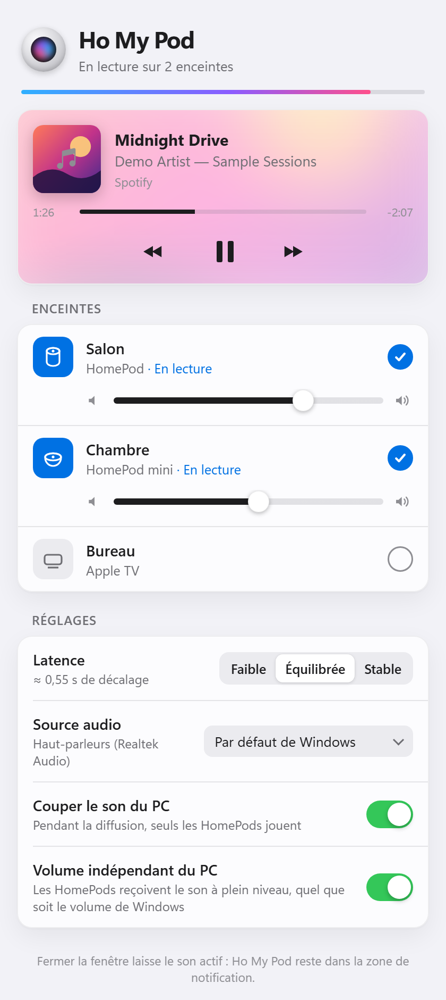
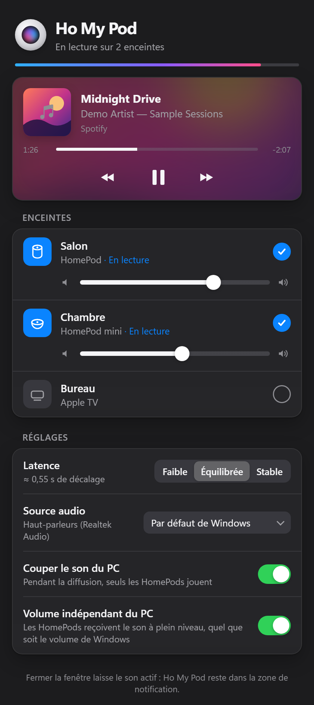
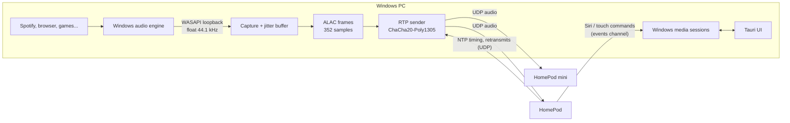

# Ho My Pod

**Stream your Windows PC's audio to HomePods over AirPlay 2, with Siri controls and a now-playing card.**

[](#quick-start)
[](https://www.rust-lang.org)
[](https://tauri.app)
[](docs/airplay2-notes.md)
[](LICENSE)

> 🇫🇷 **En bref** : une app Windows façon iOS qui envoie tout le son du PC sur un ou plusieurs HomePods,
> synchronisés. Les enceintes du PC se coupent pendant la diffusion, Spotify s'affiche dans l'app, et
> « Dis Siri, pause » ou un toucher sur le HomePod pilote la musique du PC. L'émetteur AirPlay 2 est écrit
> de zéro en Rust. L'interface est en français.

<p align="center">
  
  &nbsp;&nbsp;
  
</p>

Windows has no AirPlay. Ho My Pod captures everything the PC plays and sends it to your HomePods as a
regular AirPlay 2 source, the way an iPhone or a Mac would. Pick one speaker or several: they play in
sync, each with its own volume. A tray icon keeps it running in the background.

The AirPlay 2 sender (pairing, encrypted RTSP, RTP audio, clock sync) is written from scratch in Rust,
following the open-source [OwnTone](https://github.com/owntone/owntone-server) server. It is tested on a
HomePod (1st generation) and a HomePod mini.

## Contents

- [Quick start](#quick-start)
- [Everyday use](#everyday-use)
- [Features](#features)
- [How it works](#how-it-works)
- [Protocol highlights](#protocol-highlights)
- [Latency and volume](#latency-and-volume)
- [Command-line tool](#command-line-tool)
- [FAQ](#faq)
- [Roadmap](#roadmap)
- [Disclaimer](#disclaimer)
- [Credits](#credits)
- [License](#license)

## Quick start

Requirements: Windows 10 or 11, the PC on the same network as the HomePods, and to build it:
[Rust](https://rustup.rs) (MSVC toolchain) with the Visual Studio C++ Build Tools.

```powershell
git clone https://github.com/jxgedouard/ho-my-pod.git
cd ho-my-pod
cargo build --release              # target\release\ho-my-pod.exe
```

Or build an installer, which also adds the firewall rule:

```powershell
cargo install tauri-cli --version "^2"
cargo tauri build                  # target\release\bundle\nsis\Ho My Pod_0.1.0_x64-setup.exe
```

On first launch:

1. Click **Autoriser** in the orange banner and accept the Windows prompt. HomePods connect back to the
   PC (clock sync over UDP, Siri commands over TCP), and Windows Firewall blocks that by default. The rule
   only covers this program, and only from the local network.
2. Click a speaker. The PC's sound now plays on it.

The HomePods must accept AirPlay from the network: in the Home app, *Home Settings › Speakers & TV ›
Allow Speaker & TV Access* set to "Anyone on the Same Network" or "Everyone".

## Everyday use

| I want to... | Do this |
|---|---|
| Play on several HomePods | Tick them all: they stay in sync |
| Silence the PC speakers | On by default ("Couper le son du PC"); they come back when you stop |
| Pause or skip from the couch | "Hey Siri, pause / next song", tap the HomePod, or use the iPhone's Control Center |
| Control Spotify from the app | Use the now-playing card: play/pause, previous/next, seek |
| Hide the window | Close it: the sound keeps playing, the app stays in the tray (right-click › Quitter to exit) |
| Capture one output only | Pick it in "Source audio" instead of "Par défaut de Windows" |
| Trade delay for stability | Latency: Faible / Équilibrée / Stable |

Settings are saved in `%APPDATA%\HoMyPod\settings.json` and the release log in `%APPDATA%\HoMyPod\log.txt`.

## Features

| Feature | Details |
|---|---|
| System-wide capture | WASAPI loopback of the default output (follows it when it changes) or a chosen one |
| Multi-room | One RTP stream for all speakers, so they stay in sync. Each speaker has its own volume |
| Real volume | The slider reads the HomePod's actual volume and follows changes made by Siri, touch or an iPhone |
| PC speakers off | The PC output is muted while streaming. Windows still hands the full signal to loopback capture |
| Independent volume | The Windows volume only affects the PC speakers. HomePods get full level |
| Now playing | Artwork, title, progress and controls for any app in the Windows media flyout (Spotify, browsers, Deezer...) |
| Siri and touch controls | Pause, play, next and previous from the HomePod drive the PC's player |
| Apple-like UI | Light and dark themes, Windows 11 Mica, tray icon |

## How it works



- `src/airplay/`: the AirPlay 2 sender. `session.rs` runs the RTSP sequence (transient SRP pairing,
  encrypted control channel, SETUP, RECORD, volume, feedback), `streamer.rs` sends RTP audio, sync
  packets and retransmissions and answers the receivers' NTP requests.
- `src/capture.rs`, `src/winaudio.rs`: loopback capture, jitter buffer, Windows volume compensation
  and PC muting.
- `src/media.rs`: now playing and controls through the Windows media session API.
- `src/remote.rs`: commands coming back from the speakers.
- `src/discovery.rs`: mDNS browsing of `_airplay._tcp`.
- `src/engine.rs`, `src/main.rs`, `ui/`: the app (Tauri 2, plain HTML/CSS/JS).

## Protocol highlights

The full notes are in [docs/airplay2-notes.md](docs/airplay2-notes.md).

- **The silent firewall.** On a network marked "Public", the HomePod's NTP timing requests never reach
  the PC, so the session SETUP just times out with no error. The fix is a firewall rule, which the app
  creates for you after a UAC prompt.
- **Siri doesn't use DACP.** Old AirPlay receivers send remote commands to a `_dacp._tcp` HTTP server on
  the sender. HomePods instead send `POST /command` with a `sendMediaRemoteCommand` plist (`paus`, `nitm`,
  ...) over the encrypted AirPlay 2 events channel. Both paths are supported.
- **Mute does not mute loopback.** Measured on a software-volume output and on a sound card with hardware
  volume: when Windows mutes an endpoint, the loopback stream keeps the full signal. That is what lets the
  PC speakers go silent while the HomePods keep playing.
- **Windows volume does.** On software-volume outputs, the loopback stream is attenuated by the master
  volume (30% is about -18 dB). Capturing in float lets the app undo it exactly.
- **No codec needed.** HomePods accept ALAC "escape" frames, which are uncompressed PCM wrapped in an
  ALAC header, so there is no encoder dependency and no added latency.

## Latency and volume

AirPlay is not a real-time protocol: the speaker always buffers before playing.

| Setting | Approximate delay | For |
|---|---|---|
| Faible | ≈ 0.35 s | Solid network, ideally a wired PC |
| Équilibrée | ≈ 0.55 s | Default |
| Stable | ≈ 1.25 s | Busy Wi-Fi, dropouts |

That is fine for music. For video, the picture runs ahead of the sound: VLC and mpv can delay the video
to match.

If a HomePod at 100% sounds quieter than from an iPhone, the signal is usually turned down before it
reaches Windows: check the player's own volume slider, its volume in the Windows volume mixer, and
Spotify's volume normalization (*Settings › Playback › Volume level*: "Quiet" removes several dB).

## Command-line tool

`hmp-cli` exercises each part on its own:

```powershell
cargo build --bin hmp-cli
target\debug\hmp-cli.exe list                               # AirPlay receivers found
target\debug\hmp-cli.exe outputs                            # Windows outputs, volume, hardware/software
target\debug\hmp-cli.exe media                              # what Windows reports as playing
target\debug\hmp-cli.exe play "Kitchen" --tone --secs 5     # test tone on one speaker
target\debug\hmp-cli.exe play "Kitchen,Bedroom"             # PC audio on two speakers
target\debug\hmp-cli.exe vol-probe "Kitchen"                # volume reported by the speaker
target\debug\hmp-cli.exe loopback-test Steam --raw          # does Windows volume/mute change loopback?
target\debug\hmp-cli.exe mute-test                          # PC muted while capturing, restored after
target\debug\hmp-cli.exe remote --secs 30                   # DACP server alone, prints commands
cargo test --lib                                            # protocol unit tests
```

The CLI needs its own firewall rule: `tools\allow-firewall.ps1 target\debug\hmp-cli.exe` in an
elevated PowerShell. For debugging the app, `HMP_AUTOCONNECT="Kitchen"` connects that speaker as soon as
it is found, and `RUST_LOG=ho_my_pod=debug` gives more logs.

## FAQ

**Does it need an Apple account or the cloud?**
No. Everything stays on the local network.

**Which speakers work?**
Tested on a HomePod (1st generation) and a HomePod mini. Other AirPlay 2 receivers that accept
transient pairing (HomePod 2nd generation, Apple TV, AirPlay 2 TVs and speakers) should work but are
untested.

**Why not just use the Windows "Cast to device" menu?**
It speaks DLNA, not AirPlay, and HomePods only accept AirPlay.

**Are speakers protected by a PIN or a password supported?**
Not yet. Set the Home app's speaker access to "Anyone on the Same Network" or "Everyone".

**What if an iPhone starts playing on the same HomePod?**
A HomePod plays one AirPlay source at a time: the iPhone takes over and the app shows the connection as
lost. Click the speaker again to take it back.

**Is the interface in French?**
Yes, for now. The code and docs are in English.

## Roadmap

- [ ] Send the track title and artwork to the HomePods (shown on the iPhone's Control Center)
- [ ] PC volume keys drive the HomePods' volume
- [ ] PIN- and password-protected speakers
- [ ] macOS version. The AirPlay 2 sender (`src/airplay/`) is plain Rust and already portable. Capture
      would move to Core Audio process taps or ScreenCaptureKit, and now playing to the macOS media APIs.
- [ ] Prebuilt installer in GitHub Releases
- [ ] English interface

## Disclaimer

Ho My Pod is a personal project, not affiliated with or endorsed by Apple or Spotify. HomePod, AirPlay
and Siri are trademarks of Apple Inc. It talks to speakers the user owns, on their local network, for
interoperability. Use it at your own risk.

## Credits

[OwnTone](https://github.com/owntone/owntone-server) for its open-source AirPlay 2 sender, which this
one follows closely; [csrp](https://github.com/cocagne/csrp) for the SRP conventions Apple devices
expect; [Tauri](https://tauri.app), [wasapi-rs](https://github.com/HEnquist/wasapi-rs),
[mdns-sd](https://github.com/keepsimple1/mdns-sd) and [windows-rs](https://github.com/microsoft/windows-rs).

## License

[MIT](LICENSE)
